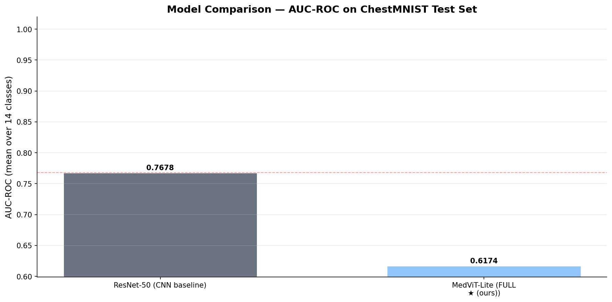

# 🩺 MedViT-Lite

[]()
[](https://www.python.org/downloads/)
[](https://pytorch.org/)
[](https://www.kaggle.com)
[](./LICENSE)

**A lightweight, adaptive Vision Transformer architecture under active investigation for resource-constrained medical imaging and streaming ultrasound diagnosis.**

> 📄 Detailed technical notes from the initial benchmark phase: [`paper/report.md`](paper/report.md)  
> *Note: This project originates from an ENSPY Master's research track on compact medical video transformers and is independent from MedViT (Manzari et al., 2023).*

---

## 🎯 Research Motivation

Deploying deep learning models in resource-constrained clinical settings (such as portable ultrasound or point-of-care screening) requires balancing **diagnostic accuracy**, **computational efficiency**, **temporal coherence**, and **calibrated uncertainty**.

**MedViT-Lite** is an ongoing research project exploring how a compact hybrid CNN–Transformer can combine three complementary mechanisms:
- **Dynamic Patch Sparsification (DPS):** focusing attention on anatomically informative patches rather than uniform background regions.
- **Selective Frame Caching (SFC):** exploiting temporal redundancy across consecutive frames in streaming medical video.
- **Hierarchical Spatial–Temporal Attention (HTA) & Uncertainty Estimation:** separating intra-frame spatial modeling from inter-frame temporal aggregation, paired with predictive uncertainty for ambiguous cases.

The repository currently hosts the **initial prototype and preliminary static-image benchmark** used to validate the training infrastructure, while the architecture and experimental suite are being extended to real streaming ultrasound video.

---

## 🏗️ Current Architecture

```text
Input Image / Frame Sequence
        │
        ▼
CNNPatchEncoder                       ← 3-layer ConvStem (÷4) + 4×4 patch projection
        │                                → 196 patch tokens + 1 [CLS] token (dim = 384)
        ▼
DynamicPatchSparsifier (DPS)          ← lightweight MLP importance scorer
        │                                (Gumbel-relaxed weighting in training, top-50% at inference)
        ▼
SelectiveFrameCache (SFC)             ← frame-level feature cache designed for video sequences
        │                                (inactive during single-image evaluation)
        ▼
HierarchicalTemporalAttention (HTA)   ← 4 intra-frame spatial self-attention blocks
        │                                + 2 inter-frame temporal [CLS] blocks (active when T > 1)
        ▼
ClassificationHead + MC Dropout       ← multi-label logits + Monte Carlo uncertainty interface
```

*Note on parameter count:* The full model contains **11.36 M parameters** (`~7.8 M` active on single-frame inputs $T=1$, plus `~3.55 M` in the temporal attention blocks reserved for multi-frame video sequences).

---

## 📊 Preliminary Results (ChestMNIST)

As a first validation step of the training and evaluation pipeline, the spatial path of MedViT-Lite was trained **from scratch** on **ChestMNIST** (112,120 chest X-rays, 14 multi-label pathologies, native $28 \times 28$ upscaled to $224 \times 224$) and compared against an ImageNet-pretrained ResNet-50 baseline:

| Model | Parameters (Total / Active) | Macro AUC-ROC ↑ | Sens@Spec95 ↑ | Macro AP ↑ | Macro F1 @ 0.5 | ECE (aggregated) |
|:---|:---:|:---:|:---:|:---:|:---:|:---:|
| **ResNet-50 (ImageNet Pretrained)** | 24.0 M / 24.0 M | **0.7678** | **0.2732** | **0.1631** | 0.0587 | 0.0124 |
| **MedViT-Lite (From Scratch)** | 11.36 M / ~7.8 M | 0.6174 | 0.1033 | 0.0772 | 0.0000 | 0.0078 |



Detailed per-pathology metrics: [`results/comparison_table.csv`](results/comparison_table.csv), [`results/medvit_lite_test_results.yaml`](results/medvit_lite_test_results.yaml), [`results/baseline_resnet50_test_results.yaml`](results/baseline_resnet50_test_results.yaml).

### 🔍 Preliminary Interpretation & Points Under Investigation
- **Discrimination & training dynamics:** MedViT-Lite learns meaningful diagnostic signal from scratch (reaching `0.797` AUC on Edema and `0.695` on Cardiomegaly), but currently trails the ResNet-50 baseline (`0.617` vs `0.768`). Beyond pretraining asymmetry and $28 \times 28$ input resolution, controlled ablations (including parameter-matched baselines trained from scratch and runs without DPS) are still needed to isolate the respective effects of early patch sparsification, data augmentation, and optimization schedule.
- **Decision thresholds & calibration:** Both the `0.000` F1 at a fixed `0.5` threshold and the low aggregated ECE (`0.0078`) require cautious interpretation under severe multi-label class imbalance and weighted BCE loss, which shifts raw probability outputs downward. Per-class calibration analysis, reliability diagrams, and validation-tuned decision thresholds are part of the next evaluation phase.
- **Temporal & efficiency hypotheses:** Because ChestMNIST consists of static images, the temporal attention blocks (`HTA` global level) and `SelectiveFrameCache` have not yet been benchmarked, and theoretical attention FLOP reductions from `DPS` remain to be measured in end-to-end wall-clock latency.

---

## 🗺️ Ongoing Work & Research Roadmap

This project is actively evolving around four main objectives:

1. **Transition to Streaming Medical Video (`EchoNet-Dynamic`):** Evaluating the full spatio-temporal architecture on real echocardiography sequences (native $112 \times 112$, 50 FPS), where temporal motion is essential for diagnosis (Ejection Fraction & systolic dysfunction) and ultrasound's fan-shaped geometry naturally aligns with patch sparsification and frame caching.
2. **Architectural Refinements (DPS & SFC):** Aligning training and inference behavior in dynamic patch selection (attention masking, ratio supervision, spatio-temporal importance scoring) and positioning frame caching ahead of spatial self-attention to measure genuine end-to-end latency and FPS gains.
3. **Experimental Rigor:** Adding parameter-matched baselines, systematic ablations (`--no-dps`, `--no-sfc`, single-frame vs. multi-frame), multi-seed evaluation, and confidence intervals.
4. **Uncertainty & Explainability Evaluation:** Benchmarking predictive uncertainty (calibration curves and selective rejection of ambiguous cases) and finalizing the Grad-CAM++ / Attention Rollout visualization pipeline with spatial remapping for sparsified tokens (currently under refinement in `explainability/` and `notebooks/`).

---

## 🔬 Reproducing Preliminary Experiments

```bash
# 1. Install dependencies
pip install -r requirements.txt

# 2. Run ResNet-50 baseline and MedViT-Lite on ChestMNIST
bash scripts/run.sh --session1

# 3. Generate comparison table and plots
python experiments/compare_results.py
```

---

## 📂 Repository Structure

```text
MedVit-Lite-Full/
├── configs/               # YAML experiment configuration
├── data/                  # ChestMNIST dataset loader
├── models/
│   ├── backbone/          # CNN patch encoder
│   ├── sparsifier/        # Dynamic Patch Sparsifier (DPS)
│   ├── cache/             # Selective Frame Cache (SFC, video mode)
│   ├── attention/         # Hierarchical Temporal Attention (HTA)
│   ├── head/              # Classification head + MC Dropout interface
│   └── medvit_lite.py     # Full model assembly
├── training/              # AMP GPU trainer, losses, metrics
├── explainability/        # Grad-CAM++ & Attention Rollout (under refinement)
├── experiments/           # Training and benchmark comparison scripts
├── results/               # Preliminary test metrics and comparison chart
├── paper/report.md        # Initial benchmark report
└── notebooks/             # Demo notebook (under refinement)
```

---

## 🏷️ Topics

`deep-learning` • `vision-transformer` • `medical-imaging` • `video-understanding` • `echocardiography` • `pytorch` • `kaggle` • `sparse-attention` • `edge-ai` • `explainable-ai`

---

## 📄 License

Distributed under the [MIT License](./LICENSE).

---

*Developed by [Feke Jimmy Wilson](https://github.com/ThePerformer0) — Master 2 Computer Engineering, ENSPY*
